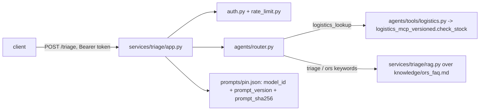

# Architecture

## Diagram

## Module boundaries
- `services/triage/`: the API boundary. `app.py` owns auth
  (`Depends(current_user)`), rate limiting, request/response validation
  (`TriageRequest`/`TriageResponse`), and loading `prompts/pin.json`.
  `auth.py` and `rate_limit.py` are unmodified copies of
  `week6_monday`'s files.
- `agents/router.py`: config-driven keyword router (`config.json`), no
  domain words hard-coded.
- `agents/tools/`: the one MCP tool this build calls. `logistics.py` is a
  thin stub-mode wrapper; `logistics_mcp_versioned.py` is an unmodified
  copy of `week8_monday`'s versioned logistics MCP server, called as plain
  Python functions (no subprocess, no protocol handshake), the same
  precedent this repo's other MCP tests use.
- `services/triage/rag.py`: grounded lookup over one pinned knowledge file
  (`knowledge/ors_faq.md`), not an embeddings index -- the corpus is one
  sentence, matching this week's fixture-scale rule.
- `docs/`: this pack.

## Data boundaries
`fixtures/triage_messages_sample.jsonl` holds only router-label training
rows (`triage` / `logistics_lookup` / `catalog_mismatch` strings and
short synthetic phrases) -- no patient narrative, no buyer phone numbers.
The optional Week 10 catalog-mismatch lane is deferred (see
`services/catalog/README.md`); if built later, its listing fixture would
live under its own path and never share a file with the triage fixture,
per this project's fixture-boundary rule.
